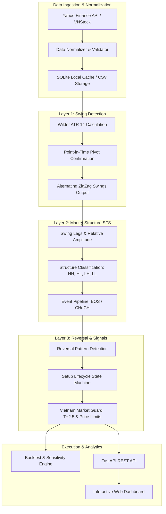

# VNStock Price Action — Quantitative Market Structure & Trading System

[](https://www.python.org/)
[](https://fastapi.tiangolo.com/)
[](https://docs.pytest.org/)
[](LICENSE)

Nền tảng phân tích định lượng (Quantitative Analysis) và nhận diện cấu trúc thị trường chứng khoán Việt Nam (HOSE, VN30). Hệ thống ứng dụng phương pháp Price Action (Smart Money Concepts / John Lucas Pruni), thuật toán phát hiện Swing Point Point-in-Time (loại bỏ hoàn toàn Look-ahead Bias) và tích hợp Dashboard trực quan hóa với FastAPI.

---

## 🌟 Tính Năng Nổi Bật (Key Features)

- **Kiến trúc phân tầng độc lập (3-Layer Decoupled Architecture):** Tách bạch hoàn toàn giữa phát hiện cực trị (Layer 1), dựng cấu trúc thị trường (Layer 2) và kích hoạt tín hiệu đảo chiều (Layer 3).
- **Phát hiện Swing Point chuẩn hóa (Point-in-Time):** Sử dụng Wilder's ATR(14) kết hợp ngưỡng lọc động ($k \times \text{ATR}$) và cửa sổ xác nhận $(L, R)$ nến, đảm bảo không có Look-ahead Bias khi replay dữ liệu.
- **Dựng Cấu Trúc Thị Trường (Market Structure Engine):** Tự động nhận diện các đỉnh/đáy cao dần (HH/HL), thấp dần (LH/LL), phân đoạn sóng (Swing Legs), Break of Structure (BOS) và Change of Character (CHoCH).
- **Nhận diện Tín hiệu Đảo chiều (Reversal Setup Detection):** Quản lý vòng đời tín hiệu (State Machine: CANDIDATE → ACTIVE → TRIGGERED → INVALIDATED) phù hợp với chu kỳ T+2.5 và biên độ trần/sàn $\pm 7\%$ của TTCK Việt Nam.
- **Engine Backtest & Đánh giá Rủi ro:** Mô phỏng khớp lệnh thực tế tính trượt giá (slippage), phí giao dịch, và các chỉ số hiệu suất (Sharpe Ratio, Max Drawdown, Win Rate, Profit Factor).
- **Web Dashboard Trực Quan (FastAPI + Modern UI):** Cung cấp giao diện biểu đồ nến, bảng tín hiệu thời gian thực, bảng xếp hạng sức mạnh cổ phiếu và xuất báo cáo.
- **Collector Dữ liệu Intraday 15M:** Module tự động thu thập và chuẩn hóa dữ liệu OHLCV 15 phút cho rổ VN30 từ nguồn Yahoo Finance & VNStock API.

---

## 🏗️ Kiến Trúc Hệ Thống (Architecture)



---

## 📁 Cấu Trúc Thư Mục (Project Structure)

```text
vnstock-price-action/
├── assets/                     # Logo và tài nguyên đồ họa
├── common/                     # Module dùng chung (Data models, I/O, formatters)
├── config/                     # Cấu hình baseline và tham số quy tắc
├── data/                       # Dữ liệu nến mẫu (HPG 15m), danh mục cổ phiếu
│   ├── hpg_15m_sample.csv      # Sample nến 15 phút HPG phục vụ demo/test
│   └── vietnam_stocks.csv      # Universe danh mục cổ phiếu Việt Nam
├── docs/                       # Tài liệu đặc tả kỹ thuật
│   ├── SFS_LAYER2_v1.0.md      # Đặc tả quy tắc cấu trúc Layer 2
│   ├── SPEC_LAYER3_v1.0.md     # Đặc tả thuật toán nhận diện đảo chiều Layer 3
│   └── WINDOWS_VN30_COLLECTOR.md # Hướng dẫn thiết lập Task Scheduler
├── extensions/                 # Các tiện ích mở rộng
│   ├── daily_15m_collector/    # Collector tự động thu thập dữ liệu 15m cho VN30
│   └── vn30_expansion/         # Replay runner cho toàn bộ danh mục VN30
├── reversal_setup_detector/    # Core Layer 3: Thuật toán nhận diện setup đảo chiều
├── sql/                        # Schema cơ sở dữ liệu SQLite / Oracle
├── src/                        # Mã nguồn chính của nền tảng
│   ├── backtest/               # Execution Engine, tham số và chỉ số hiệu suất
│   ├── strategy/               # Chiến lược John Lucas Pruni, FVG, Gann Box
│   └── web/                    # Backend FastAPI, API endpoints, Authentication
├── structure_builder/          # Core Layer 2: Dựng cấu trúc thị trường độc lập
├── structure_builder_sfs/      # Quy tắc SFS tiêu chuẩn hóa
├── swing_detector/             # Core Layer 1: Phát hiện đỉnh/đáy Wilder ATR
├── tests/                      # Bộ kiểm thử tự động toàn diện (Unit & Integration tests)
├── inspect_swings.py           # CLI trực quan hóa đỉnh/đáy & nhãn cấu trúc
├── layer1_cli.py               # CLI chạy độc lập thuật toán Layer 1
├── main.py                     # CLI quản lý thu thập dữ liệu thị trường
├── run_pipeline.py             # Script chạy trọn vẹn pipeline Layer 1 -> Layer 2
├── sync_all_symbols.py         # CLI đồng bộ danh mục mã cổ phiếu
├── web_app.py                  # Launcher khởi chạy Web Dashboard
├── requirements.txt            # Danh sách thư viện phụ thuộc
└── README.md                   # Tài liệu dự án
```

---

## 🚀 Hướng Dẫn Cài Đặt (Quickstart)

### 1. Yêu cầu hệ thống
- **Python:** Phiên bản 3.10 trở lên (khuyến nghị Python 3.12).
- **Hệ điều hành:** Windows, macOS hoặc Linux.

### 2. Thiết lập môi trường

```bash
# Clone repository
git clone https://github.com/web707/vnstock-price-action.git
cd vnstock-price-action

# Tạo và kích hoạt virtual environment
python -m venv .venv

# Windows (PowerShell):
.\.venv\Scripts\Activate.ps1
# Linux / macOS:
source .venv/bin/activate

# Cài đặt các thư viện cần thiết
pip install -r requirements.txt
```

---

## 💻 Hướng Dẫn Sử Dụng (Usage)

### 1. Chạy Pipeline phân tích cấu trúc thị trường (Layer 1 + Layer 2)
Phân tích dữ liệu nến 15 phút của mã cổ phiếu (mặc định sử dụng sample nến HPG):

```bash
python run_pipeline.py --csv data/hpg_15m_sample.csv --symbol HPG
```

**Kết quả xuất ra console:**
- Danh sách cực trị Swings (Giá, ATR, Ngưỡng $T_i$, độ trễ nến xác nhận, Volume/Median).
- Bảng cấu trúc thị trường (Phân loại xu hướng UP/DOWN/UNCLEAR, bằng chứng xác nhận).

### 2. Khởi chạy Web Dashboard
Giao diện web trực quan hóa biểu đồ, tín hiệu và backtest:

```bash
python web_app.py --port 8000
```
Mở trình duyệt truy cập: **`http://localhost:8000`**

### 3. Thu thập dữ liệu nến 15 phút cho rổ VN30
Sử dụng collector tự động từ Yahoo Finance:

```bash
python extensions/daily_15m_collector/collect_vn30_yahoo.py --fallback-59
```

### 4. Kiểm tra Swings độc lập qua CLI
```bash
python inspect_swings.py --symbol HPG --timeframe 15m
```

---

## 🧪 Kiểm Thử Tự Động (Testing)

Dự án được bảo vệ bởi bộ test tự động toàn diện bao quát tất cả các tầng thuật toán:

```bash
# Chạy toàn bộ test suite
pytest

# Chạy kiểm thử cho riêng module phát hiện Swing (Layer 1)
pytest tests/test_swing_detection.py tests/test_layer1_revision.py

# Chạy kiểm thử cho Cấu trúc thị trường SFS (Layer 2)
pytest tests/sfs/

# Chạy kiểm thử cho Nhận diện Đảo chiều (Layer 3)
pytest reversal_setup_detector/tests/

# Chạy kiểm thử cho Backtest Engine và Chiến lược
pytest tests/test_backtest.py tests/test_strategy.py
```

---

## 🛠️ Công Nghệ Sử Dụng (Tech Stack)

| Lĩnh vực | Công nghệ |
|---|---|
| **Ngôn ngữ** | Python 3.12 |
| **Phân tích dữ liệu & Tính toán** | NumPy, Pandas, SciPy, Scikit-learn |
| **Dữ liệu tài chính** | Yahoo Finance (`yfinance`), VNStock API |
| **Backend & REST API** | FastAPI, Uvicorn, Starlette, Pydantic |
| **Cơ sở dữ liệu** | SQLite3, Oracle Database (`oracledb`) |
| **Báo cáo & Trực quan** | ReportLab, Jinja2, HTML5/CSS3/JavaScript |
| **Kiểm thử** | Pytest, Pytest-Asyncio, Unittest |

---

## 📄 Bản Quyền & Giấy Phép (License)

Dự án được phát hành theo giấy phép **MIT License**. Phục vụ mục đích học tập, nghiên cứu định lượng và phát triển thuật toán giao dịch tài chính.
